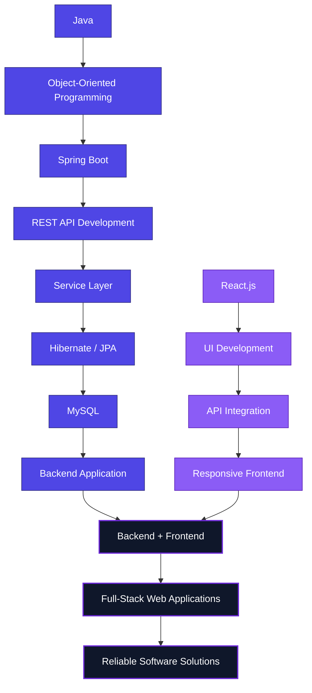

### Entry-Level Software Engineer&nbsp;|&nbsp;Java Full Stack Developer

Building reliable backend systems, REST APIs and full-stack web applications with **Java, Spring Boot, MySQL and React.js**.

 

 

## 🧩 Tech Stack

**Backend Engineering**

**Frontend Development**

**Database**

**Developer Tools**

 

## 👨‍💻 About Me

Entry-level Software Engineer focused on Java backend development and full-stack web application development. I build RESTful APIs, work with relational databases, implement application security, and integrate responsive frontend interfaces. My focus is clean code, maintainable architecture, problem solving, and building practical software solutions.

<table>
<tr>
<td valign="top" width="50%">

**Role**
Entry-Level Software Engineer

**Specialization**
Java Backend & Full Stack Development

**Backend**
Java • Spring Boot • REST APIs • Hibernate/JPA

</td>
<td valign="top" width="50%">

**Frontend**
JavaScript • React.js *(Basic)*

**Database**
MySQL • SQL

**Tools**
Git • GitHub • Maven • Postman

</td>
</tr>
</table>

 

## ⚙️ Engineering Skills

<table>
<tr>
<th>Backend Engineering</th>
<th>Frontend Engineering</th>
<th>Database Engineering</th>
<th>Development Tools</th>
</tr>
<tr>
<td valign="top">

- Java
- OOP
- Spring Boot
- Spring MVC
- Spring Security
- REST APIs
- Hibernate
- JPA
- JDBC

</td>
<td valign="top">

- HTML5
- CSS3
- JavaScript
- React.js *(Basic)*
- Responsive UI
- API Integration

</td>
<td valign="top">

- MySQL
- SQL
- Database Design
- JPA/Hibernate

</td>
<td valign="top">

- Git
- GitHub
- Maven
- Postman
- VS Code
- Eclipse

</td>
</tr>
</table>

 

## ⚙️ Software Engineering Focus

<!--
Fallback (if Mermaid does not render in your viewer):
Java -> OOP -> Spring Boot -> REST API Development -> Service Layer -> Hibernate/JPA -> MySQL -> Backend Application
React.js -> UI Development -> API Integration -> Responsive Frontend
Backend Application + Responsive Frontend -> Full-Stack Web Applications -> Reliable Software Solutions
-->

 

## 📚 Engineering Growth

**Currently Learning:**

 

## 🚀 Engineering Roadmap

> Planned projects — not yet built.

- [ ] Full-Stack Java Application
- [ ] Spring Boot REST API Project
- [ ] Authentication & Authorization System
- [ ] React + Spring Boot Application
- [ ] Database-Driven Application

 

## 💼 Featured Projects

### 🚀 CampusHub — Student Attendance Management System

Full-stack attendance management system built with React.js, Spring Boot REST APIs, Hibernate and MySQL.

**Architecture:** `React.js → Axios → REST APIs → Spring Boot → Hibernate → MySQL`

<table>
<tr>
<td valign="top" width="50%">

- User Management
- Student Management
- Subject Management
- Attendance Management
- CRUD Operations

</td>
<td valign="top" width="50%">

- Admin & Faculty Roles
- Role-Based Authentication
- Protected Routing
- Separate Dashboards
- Axios Integration & Reusable React Components

</td>
</tr>
</table>

 

### 💼 Modern Employee Tracker — Employee Management System

Employee management application built with Java 17, Spring Boot MVC, Hibernate/JPA, JSP/JSTL and MySQL.

**Architecture:** `JSP / HTML / CSS / JavaScript → Spring Boot MVC → Hibernate/JPA → MySQL`

<table>
<tr>
<td valign="top" width="50%">

- Employee CRUD
- Employee lifecycle management
- Form validation
- Confirmation modal
- Dashboard with animated counters

</td>
<td valign="top" width="50%">

- Department analytics
- Active/inactive visualization
- Search, filtering, sorting & pagination
- Dark/light theme

</td>
</tr>
</table>

 

### 🌐 mohit-portfolio

Personal portfolio project.

 

## 📊 GitHub Statistics

 

## 🎓 Education

**G H Raisoni College of Engineering and Management**
B.Tech in Information Technology · 2022–2026

**D. G. B. Agri Vidyalay and Junior College**
HSC Science · 2020–2022

 

## 📜 Certification

Java Full Stack Certification — Kiran Academy, Pune

 

## 🧠 Engineering Principles

 

> *"Write code that is readable today, maintainable tomorrow, and useful in the real world."*

 

## 📬 Contact

 

